<p align="center">
  <picture>
    <source
      media="(prefers-color-scheme: dark)"
      srcset="https://raw.githubusercontent.com/zubeir-Abubakar/zubeir-Abubakar/main/zubeir-Abubakar-banner/art/header-dark.svg"
    />
    
  </picture>
</p>


<!-- ========================================================= -->
<!--                  ABUBAKAR TOWFIQ                          -->
<!--                    PROFILE README                          -->
<!-- ========================================================= -->

<!-- RESPONSIVE LIGHT / DARK BANNER -->

<p align="center">
  <picture>
    <source media="(prefers-color-scheme: dark)" srcset="./art/header-dark.svg" />
    
  </picture>
</p>

<h1 align="center">Hey there, I'm Abubakar Towfiq 👋</h1>

<h3 align="center">
  Senior QA Automation Engineer | SDET | Quality Engineering
</h3>

<p align="center">
  <a href="https://readme-typing-svg.demolab.com">
    
  </a>
</p>

<p align="center">
  <a href="https://github.com/zubeir-Abubakar">
    
  </a>
  <a href="https://github.com/zubeir-Abubakar?tab=repositories">
    
  </a>
  
</p>

<br/>

<p align="center">
  <a href="https://abubakar-ochre.vercel.app">
    
  </a>
  
  
</p>

---

<!-- ABOUT ME -->

<h2 align="center">💫 About Me</h2>

<table width="100%" border="0">
<tr>
<td width="65%" valign="middle">

### 👨‍💻 Who Am I?

I'm **Abubakar Towfiq**, a Senior QA Automation Engineer (SDET) based in Lausanne, Switzerland.

With 5+ years of experience in software quality assurance, I specialize in designing automation strategies, building scalable testing frameworks, and delivering reliable software across complex applications.

My experience spans fintech, web applications, mobile platforms, backend systems, and API integrations.

I believe quality engineering goes beyond finding bugs. It's about preventing defects, reducing delivery risks, and building confidence in every release.

### 🚀 What I Bring

- End-to-end test automation with Playwright, Cypress and Selenium.
- API testing and backend validation using REST Assured and Postman.
- Data validation and database testing using SQL.
- Performance and load testing with JMeter and k6.
- CI/CD integration with Jenkins and Azure DevOps.
- Mobile testing with Appium and exposure to Espresso/XCUITest.
- Test strategy, risk analysis, regression testing and release validation.
- Cross-functional collaboration with engineering and product teams.

### 🎯 Current Interests

- Modern test automation architecture.
- Reliable CI/CD quality gates.
- API and data-driven testing.
- Scalable testing strategies.
- Continuous improvement in software delivery.

### 💡 My Philosophy

> Anyone who does not value good clean code does not have the right to consume it.

</td>

<td width="35%" align="center" valign="middle">


<br/><br/>

<strong>Abubakar Towfiq</strong>

Senior QA Engineer | SDET

📍 Lausanne, Switzerland 🇨🇭

🌍 Open to opportunities

<br/>

<a href="https://abubakar-ochre.vercel.app">
  
</a>

<br/><br/>

<a href="https://github.com/zubeir-Abubakar">
  
</a>

</td>
</tr>
</table>

---

<!-- PROFESSIONAL EXPERIENCE -->

<h2 align="center">💼 Professional Experience</h2>

<h3>🔹 Lead QA Engineer — Cashia</h3>

<p>
  
  
</p>

- Led quality assurance activities across fintech applications and business-critical platforms.
- Designed and maintained automated testing strategies.
- Worked with Cypress, Playwright, Selenium, SQL and Jira.
- Validated payment gateway integrations, KYC workflows and backend processes.
- Supported release decisions through structured test execution and defect analysis.
- Contributed to automation framework migration and optimization.

**Achievement:** Reduced testing cycle time by approximately 40%, from 24 hours to 12 hours, through automation improvements.

<h3>🔹 QA Engineer / V&V Test Lead — Nobilis</h3>

<p>
  
  
</p>

- Worked on Siemens SIMARIS V2 power-system calculation software.
- Supported verification and validation activities.
- Designed and executed test scenarios based on product requirements.
- Worked with Cypress, Selenium and Jenkins.
- Contributed to test planning, risk analysis and release validation.

---

<!-- TECH STACK -->

<h2 align="center">🛠️ Tech Stack & Tools</h2>

<p align="center">
  Technologies I work with across automation, quality engineering, API testing and software delivery.
</p>

<h3 align="center">💻 Programming Languages</h3>

<p align="center">
  
</p>

<h3 align="center">🧪 Test Automation</h3>

<p align="center">
  
</p>

<p align="center">
  
  
  
  
</p>

<h3 align="center">🌐 API & Performance Testing</h3>

<p align="center">
  
  
  
  
  
</p>

<h3 align="center">⚙️ DevOps & CI/CD</h3>

<p align="center">
  
</p>

<h3 align="center">🗄️ Databases & Messaging</h3>

<p align="center">
  
</p>

<p align="center">
  
  
</p>

<h3 align="center">📋 Project Management & Test Management</h3>

<p align="center">
  
  
  
  
</p>

---

<!-- SELECTED PROJECTS -->

<h2 align="center">🚀 Selected Projects</h2>

<p align="center">
  A selection of my public GitHub projects and development work.
</p>

<table width="100%">
<tr>
<td width="50%" valign="top">

<h3 align="center">🌾 Farm Overflow</h3>

<p align="center">
  <a href="https://github.com/zubeir-Abubakar/overflow">
    
  </a>
</p>

A Python/Flask web application designed for farmers to create accounts, publish posts, manage profiles, and interact through comments.

**Technologies:** Python, Flask, HTML.

</td>
<td width="50%" valign="top">

<h3 align="center">🎈 Flying Balloons</h3>

<p align="center">
  <a href="https://github.com/zubeir-Abubakar/Flying-Ballons-Animation-">
    
  </a>
</p>

A JavaScript animation project featuring animated flying balloons.

**Technologies:** JavaScript, HTML.

</td>
</tr>

<tr>
<td width="50%" valign="top">

<h3 align="center">📈 WebApp</h3>

<p align="center">
  <a href="https://github.com/zubeir-Abubakar/WebApp">
    
  </a>
</p>

A web application designed to display stock growth information over a selected period using Quandl data.

**Technologies:** JavaScript.

</td>
<td width="50%" valign="top">

<h3 align="center">✈️ Travel</h3>

<p align="center">
  <a href="https://github.com/zubeir-Abubakar/travel">
    
  </a>
</p>

A web development project built with HTML.

**Technologies:** HTML.

</td>
</tr>
</table>

<p align="center">
  <a href="https://github.com/zubeir-Abubakar?tab=repositories">
    
  </a>
</p>

---

<!-- GITHUB STATISTICS -->

<h2 align="center">📊 GitHub Statistics</h2>

<p align="center">
  <i>Every commit is a step towards better engineering.</i>
</p>

<p align="center">
  
  
</p>

<h3 align="center">🔥 Contribution Streak</h3>

<p align="center">
  
</p>

<h3 align="center">📈 Contribution Activity</h3>

<p align="center">
  
</p>

---

<!-- CONTRIBUTION SNAKE -->

<h2 align="center">🐍 Contribution Snake</h2>

<p align="center">
  <i>My contributions, visualized one commit at a time.</i>
</p>

<p align="center">
  <picture>
    <source media="(prefers-color-scheme: dark)" srcset="https://raw.githubusercontent.com/zubeir-Abubakar/zubeir-Abubakar/output/github-contribution-grid-snake-dark.svg"/>
    
  </picture>
</p>

<!--
IMPORTANT:
Create .github/workflows/snake.yml

The following GitHub Action generates the snake animation
and publishes it to the output branch.
-->

<details>
<summary><b>⚙️ Contribution Snake — GitHub Actions Configuration</b></summary>

Create:

`.github/workflows/snake.yml`

```yaml
name: Generate Contribution Snake

on:
  schedule:
    - cron: "0 */12 * * *"
  workflow_dispatch:
  push:
    branches:
      - main

permissions:
  contents: write

jobs:
  generate:
    runs-on: ubuntu-latest

    steps:
      - name: Generate Snake
        uses: Platane/snk@v3
        with:
          github_user_name: zubeir-Abubakar
          outputs: |
            dist/github-contribution-grid-snake.svg
            dist/github-contribution-grid-snake-dark.svg?palette=github-dark

      - name: Deploy to Output Branch
        uses: crazy-max/ghaction-github-pages@v4
        with:
          target_branch: output
          build_dir: dist
        env:
          GITHUB_TOKEN: ${{ secrets.GITHUB_TOKEN }}
```

</details>

---

<!-- CONNECT -->

<h2 align="center">🌐 Let's Connect</h2>

<p align="center">
  Interested in quality engineering, automation, software development, or collaboration?
  Let's connect.
</p>

<p align="center">
  <a href="https://github.com/zubeir-Abubakar">
    
  </a>
  <a href="https://abubakar-ochre.vercel.app">
    
  </a>
</p>

<!-- Add your verified social profile URLs when available:
LinkedIn:
X:
Instagram:
TikTok:
YouTube:
Professional Email:
-->

---

<!-- CLOSING -->

<h3 align="center">💙 Thanks for Stopping By!</h3>

<p align="center">
  <b>Clean Code. Reliable Software. Exceptional Quality.</b>
</p>

<p align="center">
  <i>Building better software, one test at a time.</i>
</p>

<div align="center">
  
</div>

<p align="center">
  <sub>Designed & Built by Abubakar Towfiq © 2026</sub>
</p>
